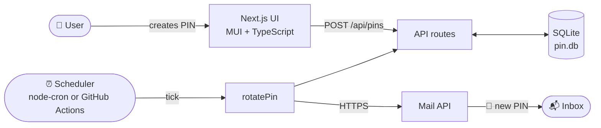
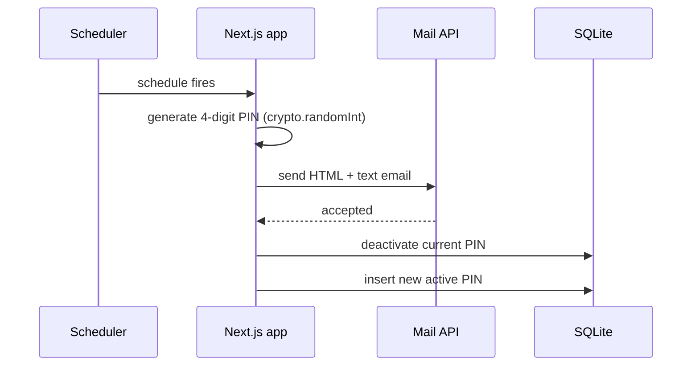

<div align="center">

# 🔐 Pin Rotator

### A tiny full-stack app that creates, rotates and emails your PIN on a schedule.

**Pick a PIN → it rotates automatically → the new one lands in your inbox.**

<br />


<br /><br />

`[ 4 ]` `[ 8 ]` `[ 2 ]` `[ 1 ]`

</div>

---

## ✨ Features

- 🔢 **Smooth PIN entry.** Four digit boxes with auto-advance, digits-only input, and Backspace that steps back through empty boxes.
- ✅ **Confirm step.** The Submit button stays disabled until both rows match.
- ⌨️ **Anime-style typewriter headings** in a cursive font, built with `react-type-animation`.
- 🔁 **Automatic rotation.** A scheduled job generates a fresh cryptographically random PIN and deactivates the old one.
- 📧 **Beautiful email delivery.** The new PIN arrives in an HTML email (with a plain-text fallback) sent through an HTTPS mail API.
- 🧱 **One active PIN, enforced by the database.** A partial unique index makes a second active PIN impossible, even under concurrent requests.
- 🙈 **PINs never leave the API.** `GET /api/pins` returns ids and status only.
- 🍞 **Snackbar feedback** for success and error states.
- 🐳 **Docker-ready** and deployable on a free host.

---

## 🧰 Tech stack

| Layer | Tools |
| --- | --- |
| Framework | [Next.js](https://nextjs.org/) (App Router) + React |
| Language | TypeScript |
| UI | [Material UI](https://mui.com/), `react-type-animation`, `next/font` |
| Database | SQLite via `sqlite3` |
| Scheduling | `node-cron` through Next.js `instrumentation.ts`, or an external trigger |
| Email | Transactional email HTTPS API (Mailjet in this setup, swappable) |
| Tooling | pnpm, tsx, Docker |

---

## 🏗️ How it works



### Rotation sequence



> **Why email first?** If the email fails, the old PIN stays active. You are never left with a PIN that nobody received.

---

## 🚀 Quick start

### Prerequisites

- **Node.js 24** (or a version your `package.json` allows)
- **pnpm 10+**
- A C/C++ toolchain only if `sqlite3` has to compile (`build-essential` and `python3` on Ubuntu)

### 1. Clone and install

```bash
git clone https://github.com/YOUR-USERNAME/pin-rotator.git
cd pin-rotator
pnpm install
```

### 2. Configure the environment

```bash
cp .env.example .env
```

Fill in the values (see [Environment variables](#-environment-variables)).

### 3. Create the database tables

```bash
pnpm migrate
```

### 4. Run it

```bash
pnpm dev
```

Open <http://localhost:3000> 🎉

---

## 🔧 Environment variables

| Variable | Required | Description |
| --- | :---: | --- |
| `MAILJET_API_KEY` | ✅ | Mail API key |
| `MAILJET_SECRET_KEY` | ✅ | Mail API secret |
| `MAIL_FROM_EMAIL` | ✅ | A **verified** sender address |
| `MAIL_FROM_NAME` | | Display name, e.g. `Pin Rotator` |
| `MAIL_TO` | ✅ | Where the new PIN is delivered |

Generate a strong secret:

```bash
openssl rand -hex 32
```

> 🔒 Never commit `.env`. It is already in `.gitignore` and `.dockerignore`.

---

## 📜 Scripts

| Command | What it does |
| --- | --- |
| `pnpm dev` | Start the dev server |
| `pnpm build` | Production build |
| `pnpm start` | Run the production build |
| `pnpm migrate` | Create or update the database tables |
| `pnpm exec tsx --env-file=.env scripts/test-mail.ts` | Send a test email |
| `pnpm exec tsx scripts/preview-email.ts` | Write `email-preview.html` to preview the template |

---

## 🌐 API reference

### `POST /api/pins`

Create a PIN. If it is active (the default), the previous active PIN is deactivated first.

```bash
curl -i -X POST http://localhost:3000/api/pins \
  -H "Content-Type: application/json" \
  -d '{"pin_value": "1234", "active": true}'
```

| Status | Meaning |
| --- | --- |
| `201` | PIN created |
| `400` | Invalid JSON, missing `pin_value`, or `active` is not a boolean |
| `409` | Another PIN is already active (a concurrent request won the race) |
| `500` | Database error |

### `POST /api/cron/rotate`


## ⏰ Scheduling

Pick **one** of these, never both, or the PIN rotates twice.

### Option A: in-process cron (always-on servers)

`src/instrumentation.ts` registers a [`node-cron`](https://github.com/node-cron/node-cron) job when the server starts:

```ts
cron.schedule("0 8 * * *", rotatePin, { timezone: "Africa/Nairobi" });
```

| Expression | Meaning |
| --- | --- |
| `0 8 * * *` | Every day at 08:00 |
| `*/15 * * * *` | Every 15 minutes |
| `0 */6 * * *` | Every 6 hours |
| `0 9 * * 1` | Mondays at 09:00 |

> ⚠️ In-process cron only fires while the server is awake. It does not work on serverless platforms or on free hosts that sleep when idle.

### Option B: external trigger (free hosts that sleep)

A scheduled GitHub Actions workflow calls the secured endpoint:

```yaml
name: Rotate PIN
on:
  schedule:
    - cron: "0 5 * * *"        # 05:00 UTC = 08:00 in Nairobi
  workflow_dispatch:

jobs:
  rotate:
    runs-on: ubuntu-latest
    steps:
      - run: |
          curl --fail --silent --show-error --max-time 120 --retry 3 --retry-delay 15 \
            -X POST "${{ secrets.APP_URL }}/api/cron/rotate" \
            -H "Authorization: Bearer ${{ secrets.CRON_SECRET }}"
```

Add `APP_URL` and `CRON_SECRET` under **Settings → Secrets and variables → Actions**.

---

## 📧 Email

Emails are sent over an **HTTPS API**, not SMTP. Many free hosts block outbound SMTP ports (25, 465, 587), while HTTPS on port 443 always works.

1. Create an account with a transactional email provider and verify a **sender address**.
2. Create an API key and put the values in `.env`.
3. Send yourself a test:

   ```bash
   pnpm exec tsx --env-file=.env scripts/test-mail.ts
   ```

The template lives in `src/lib/emailTemplates.ts` and uses table layout with inline styles so it renders consistently across Gmail, Outlook and mobile clients. The PIN is deliberately **left out of the subject line** so it never appears in notification previews.

To use a different provider, only `src/lib/mailer.ts` needs to change. Everything else calls `sendMail({ to, subject, text, html })`.

---

## 🐳 Docker

```bash
docker build -t pin-rotator .
docker run --rm -p 3100:3000 -v pin-data:/data --env-file .env pin-rotator
```

Then open <http://localhost:3100>.

- `-v pin-data:/data` keeps `pin.db` across restarts. Set `DB_PATH=/data/pin.db`.
- The image compiles `sqlite3` from source against its own glibc, so there are no "GLIBC not found" surprises.
- On start, the container runs `pnpm migrate` and then launches Next.js on `$PORT` (default 3000).

---

## ☁️ Deploying for free

| Host | Persistent SQLite? | Notes |
| --- | :---: | --- |
| Free VM (Oracle Cloud, Google Cloud e2-micro) | ✅ | Run the container with a volume and put Caddy in front for HTTPS |
| Render free web service | ❌ | Filesystem resets on restart, the service sleeps when idle, and SMTP is blocked |

On Render's free plan, expect to lose the database whenever the service restarts. Use a paid instance with a disk, or move to a hosted database, if the data matters. Free-tier terms change often, so check the provider's current pricing page.

---

## 🗂️ Project structure

> Approximate. Adjust to match your tree.

```text
pin-rotator/
├── src/
│   ├── app/
│   │   ├── api/
│   │   │   ├── pins/route.ts            # create / list PINs
│   │   │   └── cron/rotate/route.ts     # secured rotation endpoint
│   │   └── home/validate/               # validation page
│   ├── components/                      # PIN entry card
│   ├── lib/
│   │   ├── db.ts                        # SQLite connection
│   │   ├── mailer.ts                    # sendMail() over HTTPS
│   │   ├── emailTemplates.ts            # HTML + text email
│   │   └── rotatePin.ts                 # the rotation job
|   |── utils/
│       ├── migrate.ts
│       ├── test-mail.ts
|       └── preview-email.ts 
│   └── instrumentation.ts               # in-process cron
├── Dockerfile
└── README.md
```

---

## 🛡️ Security notes

- PINs are generated with Node's `crypto.randomInt`, not `Math.random`.
- The API never returns stored PIN values.
- Request bodies are validated, and database errors are logged server-side without leaking details to clients.

**Known limitations**

- PINs are stored as plain text in SQLite. Hashing them (argon2 or bcrypt) is the first item on the roadmap.
- Emailing a PIN means it sits in an inbox. For anything sensitive, prefer short-lived one-time codes.
- The API routes have no user authentication yet.

---

## 🗺️ Roadmap

- [ ] Hash stored PINs (argon2 / bcrypt)
- [ ] Authentication for the API routes
- [ ] Per-user PINs and recipients
- [ ] PIN expiry and rotation history
- [ ] Rate limiting on validation attempts
- [ ] Hosted database option (for platforms without persistent disks)
- [ ] CI workflow: lint, type-check, build

---

## 🩺 Troubleshooting

<details>
<summary><b>❌ <code>GLIBC_2.38 not found</code> or <code>Could not locate the bindings file</code> (sqlite3)</b></summary>

<br />

The prebuilt `sqlite3` binary needs a newer glibc than your system has. Build it from source:

```bash
sudo apt install build-essential python3
cd node_modules/.pnpm/sqlite3@*/node_modules/sqlite3
npx node-gyp rebuild --python=/usr/bin/python3
```

Also make sure `package.json` allows the build script:

```json
"pnpm": { "onlyBuiltDependencies": ["sqlite3"] }
```

</details>

<details>
<summary><b>❌ <code>port is already allocated</code></b></summary>

<br />

Something else is using the port. Map a different host port:

```bash
docker run --rm -p 3100:3000 pin-rotator
```

</details>

<details>
<summary><b>❌ Email fails with <code>ETIMEDOUT</code> after deploying</b></summary>

<br />

Your host is probably blocking SMTP. Use an HTTPS email API, as this project does, instead of SMTP.

</details>

<details>
<summary><b>❌ The cron job never fires</b></summary>

<br />

- `instrumentation.ts` must sit in `src/` (or the project root), not in `src/app/`.
- In-process cron only runs while the server is awake, so on a host that sleeps, use the GitHub Actions trigger.
- Watch the server logs for the `[cron]` lines.

</details>

<details>
<summary><b>❌ <code>ERR_PNPM_LOCKFILE_CONFIG_MISMATCH</code> in Docker</b></summary>

<br />

Run `pnpm install` locally and commit the updated `pnpm-lock.yaml`.

</details>

---

## 🤝 Contributing

Pull requests are welcome.

1. Fork the repo
2. Create a branch: `git checkout -b feature/my-idea`
3. Commit your changes: `git commit -m "Add my idea"`
4. Push and open a pull request

---

## 📄 License

Released under the [MIT License](LICENSE).

<div align="center">

<br />

Built with ☕, TypeScript, and a healthy fear of weak PINs.

**If this helped you, consider giving it a ⭐**

</div>